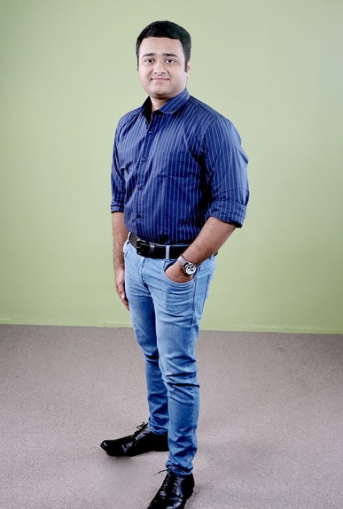

  

  
  
  
  

---

<table>
<tr>
<td width="62%" valign="top">

### 🧑‍💻 About Me

- 🎯 **Frontend Engineer → Full Stack Developer** with **3.5+ years** building scalable web apps
- 🏢 Currently **Frontend Developer @ Transond Systems** – leading a 4-member team on the *Taqadom HRMS* platform
- 🤖 Previously built **Zita**, an AI-powered Applicant Tracking System, at **Sense7AI**
- 🧱 Strong in frontend architecture, reusable components, **RBAC**, SSR & performance optimization
- 🌱 Growing my backend skills with **Node.js, Express & MongoDB**
- 🎓 B.E. CSE – Kongu Engineering College (CGPA 8.75)
- 📍 Coimbatore, Tamil Nadu, India
- 💬 Ask me about **React, Next.js, Redux & MERN**
- ⚡ Fun fact: I migrated a full website from Wix to React in just two months!

</td>
<td width="38%" align="center" valign="top">
  
</td>
</tr>
</table>

---

### 🛠️ Tech Stack

  
   
  

  
  
  
  
  
  
  
  
  
  
  
  

---

### 💼 Experience

| Role | Company | Period |
|------|---------|--------|
| **Frontend Developer** (Team Lead – 4 devs) | Transond Systems Pvt Ltd · *Taqadom HRMS* | Apr 2025 – Present |
| **Junior Software Engineer** | Sense7AI · *Zita AI-powered ATS* | Apr 2023 – Mar 2025 |

<b>✨ Highlights</b>

- Implemented **Role-Based Access Control** across the HRMS for module, feature & user-action permissions
- Built a centralized **Currency Management** module synced across Payroll, Reports & Payslips
- Developed **drag-and-drop customizable dashboards** with personalized layouts
- Built Job Description Template & Candidate Weightage Matching modules for an AI ATS
- Migrated **Zita** from Wix → React.js and **InnovSpace** → Next.js (SSR) with Node.js mailing services

---

### 🚀 Featured Projects

| Project | Description | Stack |
|---------|-------------|-------|
| [**ProShop**](https://github.com/vishalrupak7979/Proshop) | Full-featured MERN e-commerce app – cart, checkout, orders, admin dashboard, JWT auth, RBAC & Stripe payments | React · Redux Toolkit · Node · Express · MongoDB · Stripe |
| [**Portfolio**](https://github.com/vishalrupak7979/portfolio) | My personal developer portfolio | TypeScript · React |
| [**Redstore eCart**](https://github.com/vishalrupak7979/Redstore_ecart_website) | E-commerce storefront website | HTML · CSS · Node.js · MongoDB |
| [**ID Card Maker**](https://github.com/vishalrupak7979/ID-Card-Maker) | Generate ID cards in the browser | JavaScript |

---

### 📊 GitHub Stats

  
  

  

